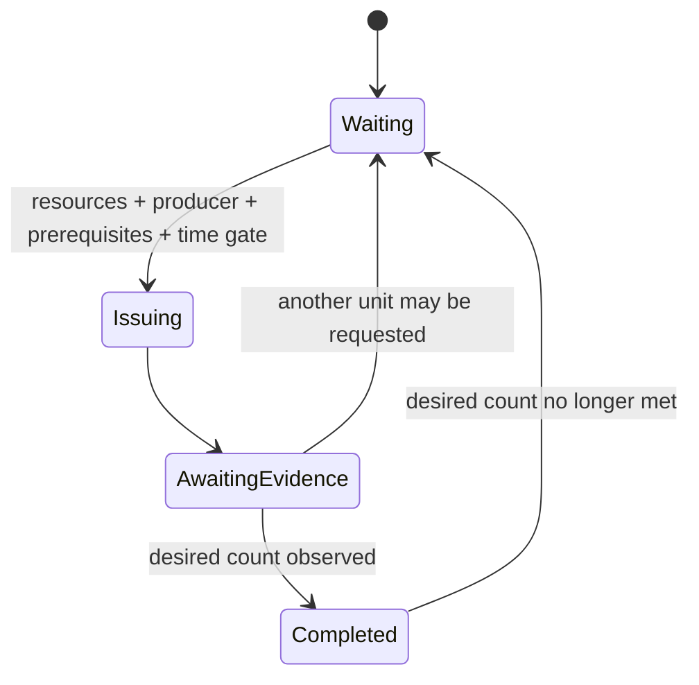

# Production plans and FSM execution

## The user-authored contract

A production plan is versioned data. It names production goals (target unit or structure, producer, desired count, earliest game loop, priority) and dependency edges between steps. It does not contain SC2 ability IDs, protocol messages, C# callbacks, or executable code. Game facts must be resolved from the active SC2 `ResponseData` catalog before an action can be submitted.

The first contract is deliberately small but composable. A cheese attack can prioritize an early structure and a concentrated unit count. A slow push can stage production through a Barracks, Factory, and Starport while independently accumulating its infantry, siege, and support components. `dependsOn` expresses hard step dependencies; independent steps may progress in parallel. Cycles, duplicate IDs, and unknown dependency IDs are rejected.

## FSM lifecycle

Each production step follows this graph:



The `Issuing` entry action emits a semantic `ProductionIntent`. It does not submit an SC2 command. The host action pipeline remains responsible for resolving the target and producer against authoritative game data, checking resources/supply/producer availability, translating to a protocol command, and reporting submission outcomes back to the context.

The context distinguishes currently completed units from in-progress production. This prevents the graph from treating a queued unit as completed or blindly issuing duplicates. A submission latch is held until the host observes the order or rejects the command. Dependency completion is supplied as an observation-derived context fact; the FSM does not infer that a building exists merely because an earlier action was requested.

## User-authored examples

- [Cheese attack example](../strategies/cheese-attack.example.json): Depot → Barracks → Marine commitment.
- [Slow push example](../strategies/slow-push.example.json): staged Barracks/Factory/Starport infrastructure with parallel unit composition.

These examples demonstrate production-plan shape, not a claim that the current runtime can execute every step. The reusable production FSM graph, JSON parser, structural validator, and dependency-cycle checks are implemented. Binding every goal to SC2 game data, evaluating all prerequisites, translating arbitrary structures/units into validated actions, and live match validation remain separate gates.

## Runtime demand and doctrine reactions

The live strategic request is a desired-total dictionary, not a stream of build commands:

```csharp
production.Set(marineFacts, 10); // desired total: 10 Marines
production.Add(marineFacts, 10); // desired total increases by 10
production.Set(barracksFacts, 2); // desired total: 2 Barracks
```

`ProductionDemandLedger` keys entries by the authoritative SC2 `UnitTypeId` resolved from the match's `ResponseData`. It stores the desired total and priority; it does not issue actions. Additive event requests can carry a correlation ID through `AddOnce`, so replaying the same event cannot repeatedly inflate the target. Demand is bounded and reset between matches.

The nervous system emits `observation.enemy-force-concern` when the number of currently visible live enemy units crosses above four. The trusted `production.respond-to-large-enemy-force.v1` BotMethod reads that event's `enemy.count` and adds ten Marines to the desired total. A doctrine must explicitly bind that event to that method. This is an example response, not a hard-coded universal strategy.

The next boundary is reconciliation: translate each ledger entry into a production objective, compare desired totals with completed and in-progress units, validate prerequisites/resources/supply/producers, and then emit intents for the host action pipeline. The current ledger is exposed as strategic intent; it is not yet connected to the live SC2 action path. Existing opening controllers remain unchanged.

## FSM_API and FSM_Execution have different jobs

- **FSM_API** owns continuously evaluated state machines: production-step lifecycles, unit FSMs, and per-frame processing groups.
- **FSM_Execution** owns ordered named workflows: a doctrine event can select a sequence of trusted BotMethods, validate the complete sequence before side effects, and execute those methods in order. The bot's doctrine dispatcher now uses the `Execution.Workflow` runner for both synchronous game-loop reactions and host-driven asynchronous dispatch.
- A game-loop BotMethod must complete synchronously. The frame adapter rejects incomplete asynchronous work; it must not block waiting for network, model, disk, or other external operations. Longer-running work belongs in a separately bounded host workflow/service and returns data to the game loop.

FSM_Execution does not replace FSM_API's per-frame state machines, and neither engine is allowed to invent SC2 actions. They coordinate trusted behavior; production reconciliation and the host action translator remain the only route from desired intent to submitted commands.

## Why plans compile to FSM_API

The runtime registers one reusable graph and creates independent FSM_API instances for each configured step. The user's plan determines data and composition; the runtime owns observation, context facts, and handle lifecycle. FSM_API owns the state-machine definition and registered instances. No second state-machine engine or user-supplied executable code is introduced.
