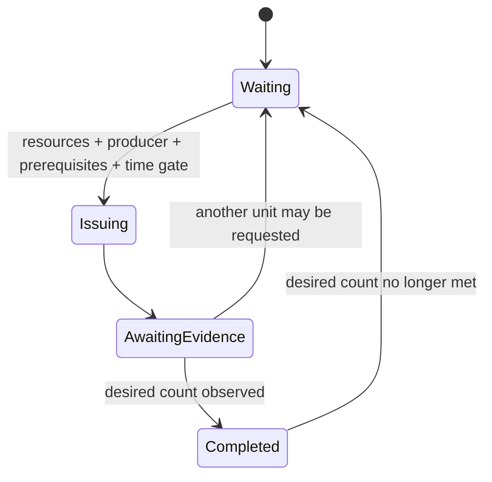

# Production plans and FSM execution

## The user-authored contract

A production plan is versioned data. It names production goals (target unit, producer, desired count, earliest game loop, priority); it does not contain SC2 ability IDs, protocol messages, C# callbacks, or executable code. Game facts must be resolved from the active SC2 `ResponseData` catalog before an action can be submitted.

The first contract is deliberately small. It gives users a stable way to describe a cheese attack or a slow push as different ordered production steps. The same step graph is reused for every step; each step gets an independent caller-owned context and FSM_API handle.

## FSM lifecycle

Each production step follows this graph:

The `Issuing` entry action emits a semantic `ProductionIntent`. It does not submit an SC2 command. The host action pipeline remains responsible for resolving the target and producer against authoritative game data, checking resources/supply/producer availability, translating to a protocol command, and reporting submission outcomes back to the context.

The context distinguishes currently completed units from in-progress production. This prevents the graph from treating a queued unit as completed or blindly issuing duplicates. A submission latch is held until the host observes the order or rejects the command.

## User-authored examples

- [Cheese attack example](../strategies/cheese-attack.example.json): a compact, early Marine commitment.
- [Slow push example](../strategies/slow-push.example.json): staged production intended to build a durable force before advancing.

These examples demonstrate production-plan shape, not a claim that the current runtime can execute every step. The production FSM graph and data validation are implemented; game-data binding, full prerequisite evaluation, action translation for arbitrary production targets, and live match validation remain separate gates.

## Why plans compile to FSM_API

The compiler should register reusable graph definitions once and create independent instances for the user's configured steps. The user's plan determines data and composition; the runtime owns observation, context facts, and handle lifecycle. FSM_API owns the state-machine definition and registered instances. No second state-machine engine or user-supplied executable code is introduced.
