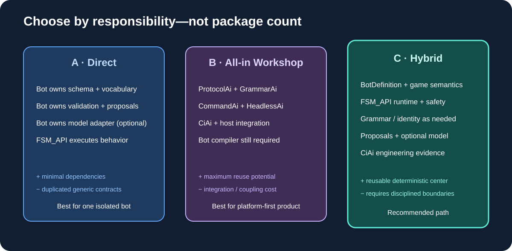

# 01 — Executive assessment

## Conclusion: choose the hybrid Workshop path

Keep the bot's real-time decision and execution loop native to SingularityBot + FSM_API. Adopt the AI-branded packages as optional contracts around authoring, structured intent, model assistance, and engineering evidence—not as mandatory dependencies in every game loop.

The packages are complementary, but they do not add up to a complete scriptable-bot product. They do not provide the bot-specific definition model, semantic compiler, FSM_API binder, strategy planner, or graphical authoring workbench. Those are the missing integration products.

## Package roles

| Concern | Owner |
|---|---|
| Match lifecycle, live observations, strategy and action authority | SingularityBot + FSM_API |
| Reusable behavior execution/cadence | FSM_API / FSM_Foundry when integrated |
| Game-specific vocabulary and capability facts | SingularityBot ontology |
| Stable cross-tool symbol identities | ProtocolAi, selectively |
| Script grammar and structural validation | GrammarAi |
| Bounded model/tool proposals | CommandAi |
| Optional model endpoint communication | HeadlessAi |
| CI provenance and engineering evidence | CiAi + GitHub Actions |
| Authoring/inspection UI | GUI / Renderer / Visualize MicroBundles |
| Match history | DataWarehouse / bot-owned persistence |

## Why the AI packages should not sit in the hot path

A remote model call is nondeterministic and can exceed a game-loop budget. A grammar proves structure, not tactical wisdom. A command proposal can be well-formed but illegal now. A recognized symbol is not proof that a game fact occurred or that an action is authorized.

Therefore no live model call is required to execute an accepted script; no AI package submits SC2 actions; unknown or stale evidence blocks aggressive adoption; all accepted goals still pass through existing arbitration, reservations, legality checks, and the SC2 adapter.

## The missing center: Bot Definition Model

Create a versioned, typed BotDefinition containing match profile, opening/builders, strategy candidates, adoption conditions, evidence sources/freshness, goals/priorities, constraints/resource budgets, FSM_API bindings, fallbacks, scenarios, and provenance.

The editor, validator, runtime binder, script file, and diagnostics must consume the same canonical model. This is the key product decision.

## Recommendation

Build the bot definition and deterministic visual inspector first. Then integrate GrammarAi/ProtocolAi for the language contract, CommandAi for bounded proposals, HeadlessAi for optional asynchronous coaching, and CiAi for verified development evidence. Keep Profiles out of the initial bot runtime; revisit it for creator identity and disclosure when those are real requirements.
