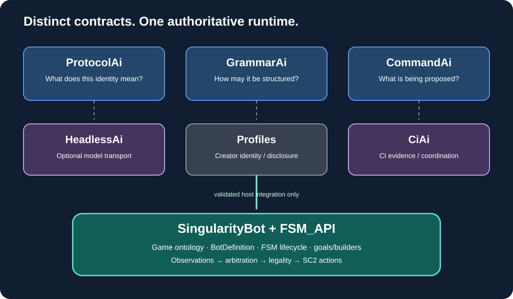

# 02 — Repository evaluations

This is a fit-for-purpose assessment: what should each repository own in a scriptable StarCraft bot?

## CommandAi — bounded intent and response contracts

[Repository](https://github.com/TrentBest/TheSingularityWorkshop.CommandAi) · [SingularityBot integration guide](https://github.com/TrentBest/TheSingularityWorkshop.CommandAi/blob/development/docs/SINGULARITYBOT_INTEGRATION.md)

Its documented capability includes immutable ordered command proposals, typed arguments, address-space input/context and output slots, exchange correlation, deterministic codecs, and structural bounds. It explicitly does not own application memory, operation meaning, authorization, dispatch, or execution. The bot-specific guide recommends high-level orders or goal requests resolved into the existing goal/FSM model—not inner per-frame control.

**Fit: high at the boundary.** A model or external tool can propose a high-level goal. The bot maps trusted action IDs to domain operations, validates current state and policy, then stages an accepted intent. CommandAi is not the strategy engine or action adapter.

## GrammarAi — structure of the bot's language

[Repository](https://github.com/TrentBest/TheSingularityWorkshop.GrammarAi) · [Knowledge mapping model](https://github.com/TrentBest/TheSingularityWorkshop.GrammarAi/blob/development/docs/KNOWLEDGE_MAPPING_MODEL.md)

It owns integer-backed grammar definitions, ordered productions, recursion, typed structural nodes/slots, cardinality, and qualified references to external vocabulary. It is not a compiler or source execution engine; the host resolves external references and owns semantic interpretation.

**Fit: very high for user-authored definitions.** It can constrain the shape of a strategy document and its predicates. The bot must still verify that each builder, race capability, ability, predicate, and target is meaningful and supported.

## ProtocolAi — stable meaning across tools

[Repository](https://github.com/TrentBest/TheSingularityWorkshop.ProtocolAi) · [Ecosystem usage map](https://github.com/TrentBest/TheSingularityWorkshop.ProtocolAi/blob/development/docs/ECOSYSTEM_USAGE_MAP.md)

It owns protocol/symbol identities and broader event/outcome provenance. GrammarAi can carry qualified protocol/symbol references without a direct ProtocolAi dependency.

**Fit: high where definitions cross boundaries.** Give stable identities to concepts shared by scripts, editor nodes, replay analysis, model exchanges, and reports. The bot ontology remains authoritative for StarCraft semantics. Do not assign an ID to every private field just because integers are available.

## HeadlessAi — optional model endpoint transport

[Repository](https://github.com/TrentBest/TheSingularityWorkshop.HeadlessAi) · [Usage guide](https://github.com/TrentBest/TheSingularityWorkshop.HeadlessAi/blob/development/docs/usage.md)

It provides configured endpoint profiles, adapters, agent templates, and request/response handling. Its guide distinguishes provider APIs from the ChatGPT website. Its CiAi integration guide states that response content remains untrusted until host validation.

**Fit: medium-high for asynchronous assistance.** Use it for strategy critique, script drafts, replay summaries, and alternatives. Put it behind a host advisor interface with timeouts, cancellation, budgets, offline fallback, and explicit review. Never wait for it per frame.

## CiAi — development and evidence orchestration

[Repository](https://github.com/TrentBest/TheSingularityWorkshop.CiAi) · [Inter-repository model](https://github.com/TrentBest/TheSingularityWorkshop.CiAi/blob/development/docs/INTER_REPOSITORY_MODEL.md)

It documents read-only CI workflow observation and prototypes for capability catalogs, requests, results, policy, and topology projection. Its own document says the Cogs are individually testable but not yet wired together; GUI and live dispatch are not implemented. Its ServerSC2 sample separates SC2 match/replay truth from CI evidence.

**Fit: high for engineering the bot; low for live decisions.** Use it to coordinate build/test/evaluation evidence. GitHub Actions remains the build executor. CiAi must not infer a match win from a green build or become a live strategy dependency.

## Profiles — adjacent identity and disclosure

[Repository](https://github.com/TrentBest/TheSingularityWorkshop.Profiles) · [Architecture](https://github.com/TrentBest/TheSingularityWorkshop.Profiles/blob/development/docs/ARCHITECTURE.md)

Profiles models entities, claims, relationships, groups, observer-specific representations, and disclosure. It does not own persistence, authentication, rendering, or authorization enforcement.

**Fit: conditional.** Useful later for creator identities, teams, bot publishing personas, and observer-specific sharing. Not a bot strategy profile and not required for the first editor.

## Relative fit

| Repository | Authoring | Runtime | Model assistance | Evidence |
|---|---:|---:|---:|---:|
| CommandAi | High | Boundary only | High | Medium |
| GrammarAi | Very high | Validation only | High | Low |
| ProtocolAi | High | Identity only | High | High provenance |
| HeadlessAi | Medium | No | Very high | Diagnostic input |
| CiAi | Low | No | Low | Very high for CI |
| Profiles | Adjacent | No | Low | Identity/disclosure |

**Finding:** the packages are complementary, but the bot-owned definition model, semantic validator, FSM_API binder, editor, and runtime evidence surface remain to be built.
