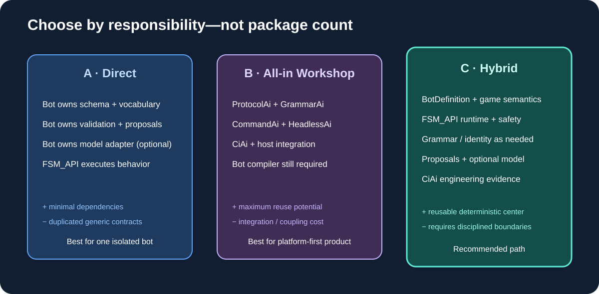

# 03 — Two paths: direct bot versus Workshop composition

<p align="center"></p>

## Path A — self-contained bot

SingularityBot owns its own strategy schema, parser/validator, vocabulary, proposal format, model adapter if needed, and evidence tooling. FSM_API remains the execution foundation.

```text
User / config
  -> Bot-owned definitions
  -> Bot-specific parser + semantic validator
  -> Match / strategy / builder model
  -> FSM_API contexts and execution
  -> intent arbitration -> legality -> SC2 adapter
```

**Advantages:** smallest dependency surface; fastest path for a narrow StarCraft-only editor; direct domain control; deterministic offline operation.

**Costs:** reimplements generic vocabulary, grammar, proposal envelopes, endpoint adapters, and evidence plumbing; risks a one-off DSL; editor, validator, and runtime can drift; cross-domain reuse is weaker.

Choose it if the immediate goal is only one bot or the generic contracts would delay the first useful vertical slice.

## Path B — compose all Workshop AI packages as the primary architecture

The editor/model uses ProtocolAi vocabulary and GrammarAi structure; CommandAi carries proposals; HeadlessAi transports model requests; the bot validates and binds definitions; CiAi supports evidence.

```text
GUI / model
  -> ProtocolAi + GrammarAi
  -> CommandAi proposals / exchanges
  -> HeadlessAi endpoint (optional)
  -> bot semantic validation
  -> BotDefinition -> FSM_API
  -> SC2 action pipeline
  -> CiAi / replay evidence
```

**Advantages:** maximum cross-domain reuse potential; shared vocabulary and grammar; typed/correlated proposals; trust boundaries already central to package design.

**Costs:** most integration/versioning work; easy to mistake structural validity for tactical correctness; still needs bot-specific compiler/planner/binder; model latency and outages; CiAi Cogs not yet fully integrated.

Choose it if a Workshop-wide authoring platform is the priority and the missing integration layer is explicitly funded.

## Path C — recommended hybrid

BotDefinition and the deterministic runtime remain central. GrammarAi validates the structural language; ProtocolAi provides stable IDs where interchange is useful; CommandAi bounds external proposals; HeadlessAi offers asynchronous advice; CiAi verifies engineering evidence; Profiles remains optional for creator/community identity.

| Dimension | A: Direct | B: All-in | C: Hybrid |
|---|---|---|---|
| First script editor | Fastest, narrow | Slowest | Fast, staged |
| Cross-domain reuse | Low-medium | Highest potential | High where justified |
| Runtime determinism | High | Depends on discipline | High by design |
| Dependencies | Lowest | Highest | Selective |
| AI authoring | Bespoke | Package composition | Optional, governed |
| Offline use | Straightforward | Fallback required | First-class |
| Maintainability | Risk of duplication | Risk of over-coupling | Best balance |

The paths are not mutually exclusive forever. Prove one vertical slice with the bot-owned model. If GrammarAi and CommandAi measurably reduce complexity, adopt them; otherwise keep the same model and implement those seams locally. That preserves the strategic option without coupling the first milestone to every package.
