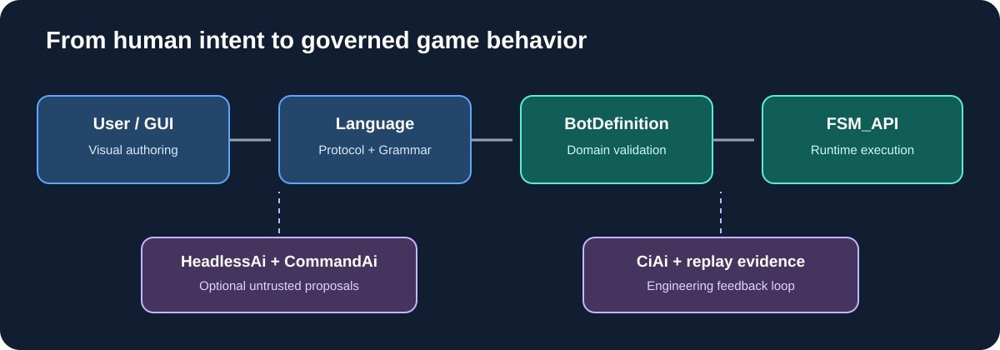

# 04 — Recommended architecture

## The center: Bot Definition Model

Create a versioned, typed, bot-owned model—not a second FSM engine and not raw executable C#.

Suggested sections:
- Identity: ID, name, author, version, supported game/mode/race.
- Opening: ordered builder/production plan and completion evidence.
- Strategies: candidates and conditional adoption policies.
- Evidence: fact kind, source, observed loop, confidence, freshness/expiry.
- Goals: outcomes and priorities.
- Constraints: resource reserves, worker safety, production feasibility, composition limits.
- Builders: references to reusable bot-domain capabilities.
- Behaviors: FSM_API-backed lifecycle and processing bindings.
- Fallbacks: safe behavior when evidence is missing, stale, contradictory, or unsupported.
- Scenarios: deterministic fixtures and replay acceptance cases.

The editor, validator, runtime binder, file format, and diagnostics all consume the same canonical model.

## Ownership and flow

1. Editor produces a candidate definition.
2. Bot validator resolves builders, strategy references, vocabulary, race/mode capability, and expression semantics.
3. GrammarAi optionally checks structural shape; ProtocolAi optionally resolves stable identities.
4. Compiler/binder creates FSM_API definitions and per-match contexts.
5. Normalized observations update evidence; FSM_API evaluates on controlled processing cadences.
6. Adopted goals enter existing arbitration, worker/resource reservation, action validation, and SC2 translation.
7. Runtime records evidence, guards, cost, decision, and outcome.
8. HeadlessAi can propose changes asynchronously; CommandAi carries bounded structured proposals. The host validates and stages them.
9. CiAi and GitHub Actions verify engineering evidence; SC2 match/replay evidence remains bot/host-owned.

## Three validation layers

| Layer | Question | Example |
|---|---|---|
| Structural | Is the definition shaped correctly? | Conditional strategy has a predicate and target |
| Domain semantic | Does each reference exist and make sense? | Terran Banshee builder is supported |
| Runtime feasibility/authority | Is it safe and executable now? | Resources, prerequisites, observation, legal action |

Passing one layer never implies passing the next.

## FSM_API binding

FSM_API remains the heartbeat and lifecycle authority. The binder translates executable behaviors into reusable FSM_API definitions and per-match contexts. The bot supplies game facts/context; FSM_API owns state transitions and update semantics.

Do not put the whole strategy language in a giant imperative switch outside FSM_API. Equally, do not make every declarative field a separate state machine. Use FSM-backed units where lifecycle, cadence, context, or transitions matter; keep pure data as data.

Adoption policy is distinct from generic game phase. It needs evidence/freshness, non-tradeable hard guards, minimum advantage, switching cost/cooldown, explicit adoption/withdrawal lifecycle, and an explanation.

## Optional package lanes

- **ProtocolAi + GrammarAi:** definition language and cross-tool identity at the boundary. Host resolves every reference against the current bot ontology.
- **CommandAi:** high-level operations such as propose strategy, change goal priority, request scouting focus, or explain a candidate. No direct Train/Attack action.
- **HeadlessAi:** replay analysis, script drafting, critique, alternatives. Async with budgets and cancellation.
- **CiAi:** exact repository/SHA/run/job/artifact/test evidence. Not a live game decision service.
- **Profiles:** revisit for creator identity, team representation, and disclosure.

Treat user-authored files, imported scripts, model output, and replay annotations as untrusted. Validate schema, IDs, versions, bounds, references, race/mode support, and semantic constraints. Stage changes and record provenance/hash. Revalidate live prerequisites before every effect. No eval or unrestricted generated code is required.
