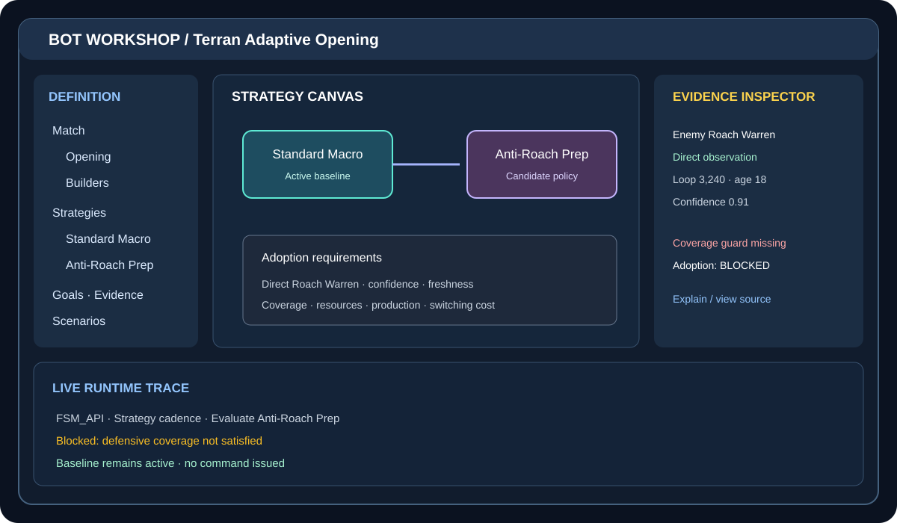

# 05 — The graphical authoring experience

## Compose a living system, not a chat prompt glued to a flowchart

The user should state a goal in ordinary language, see it become typed components, and inspect how those components relate. Each visual object needs a real definition and runtime identity.

## Proposed workspace

1. **Definition tree:** match modes, opening, strategies, goals, builders, doctrines, evidence, fallbacks, scenarios. Every node has stable identity/version and source link.
2. **Strategy canvas:** candidate strategies and conditional transitions. Edges show evidence, confidence, freshness, hard guards, advantage, switching cost, adoption, and withdrawal.
3. **Builder composition:** capabilities such as SecureSupply, EstablishBarracks, ExpandEconomy, ScoutEnemyTech, PrepareAntiRoachDefense, and ProduceAirSupport. The bot resolves them to actual builder implementations; builders do not bypass resource/worker arbitration.
4. **Evidence inspector:** observed object/owner, source/game loop, visibility, directness, confidence, age, validity, and permitted influence.
5. **Runtime inspector:** FSM/API instance/state, processing group, candidate evaluations, goals/reservations, budgets, issued/rejected intents, and action outcomes.
6. **Explain/assist panel:** draft a definition, compare alternatives, explain blocked transitions, or summarize a replay. The result is a proposed diff, never a silent live edit.

## Workshop composition

GUI, Renderer, and Visualize should be consumed as MicroBundles, not ordinary NuGet runtime dependencies. Renderer provides textual/semantic inspection; Visualize provides spatial battlefield and visual state; Physics owns spatial calculations; bot owns tactical meaning. The editor can author offline and connect to a live bot for inspection and reviewed updates.

## UX principles

Progressive disclosure, explainability, reversible/versioned edits, safe defaults, portable definition files, reusable composition, and one source of truth. A diagram is generated from the same definition/runtime data, never maintained separately.

## First useful GUI milestone

Do not begin with a massive drag-and-drop game editor. Start with a read-only inspector for one real BotDefinition: opening/builders, one conditional strategy, its evidence/guards, FSM_API binding, and a trace showing blocked and eligible transitions. Then edit one threshold, show a diff, validate, and export.
