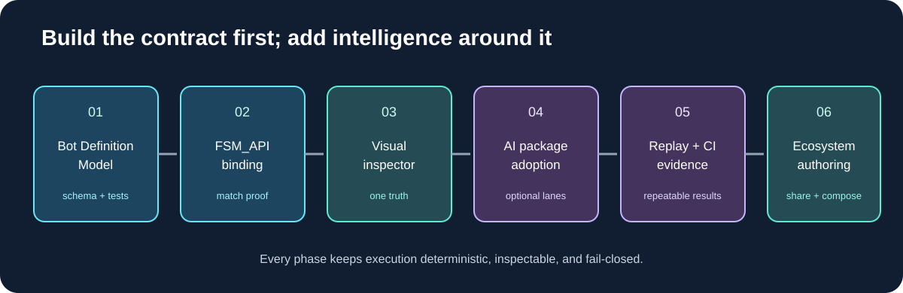

# 07 — Roadmap and decision gates

## Phase 0 — boundaries

Define package ownership, optionality, versions, and effect authority. FSM_API remains the only FSM lifecycle foundation. GUI/Renderer/Visualize remain MicroBundles. No AI package submits SC2 actions.

**Gate:** every path to a game effect has one named authority.

## Phase 1 — Bot Definition Model

Create a versioned serializable model for one Terran 1v1 opening and one conditional strategy. Include builder references, evidence predicates, hard guards, goals, switching policy, race/mode support, and provenance. Add deterministic validation and CLI diagnostics.

**Gate:** a definition loads and validates without arbitrary code execution.

## Phase 2 — FSM_API runtime binding

Bind candidate policies to FSM_API contexts using authoritative normalized SC2 observations. Connect adopted goals to existing builder/planner/action paths. Add traces for evaluation and blocked/adopted reasons.

**Gate:** tests prove lifecycle and fail-closed behavior; a local match/replay demonstrates the response. Never present synthetic test facts as live evidence.

## Phase 3 — visual inspector

Build the first GUI MicroBundle workbench: definition tree, strategy graph, builder prerequisites, evidence/guard inspector, runtime trace, one editable threshold, diff, validation, export.

**Gate:** graph is generated from the same definition/runtime data.

## Phase 4 — selective AI package adoption

Use ProtocolAi identities where cross-tool exchange matters; GrammarAi for structural grammar; CommandAi for bounded proposal/exchange; HeadlessAi for asynchronous assistance. Host validates and user reviews every proposed change.

**Gate:** malformed, unknown, stale, unauthorized, oversized, and unsupported proposals are rejected; provider outage cannot affect match execution.

## Phase 5 — replay and CI evidence

Capture replays and diagnostics; derive deterministic fixtures; compare definitions against a fixed baseline. CiAi verifies exact CI provenance and reports build/test/artifact facts. Humans review strategy changes and privileged repository mutations.

**Gate:** decisions are based on repeatable evidence, not one anecdotal win.

## Phase 6 — broader ecosystem

Add other races, team modes, FFA, tournament constraints, shareable builders, versioned strategy composition, and creator/community identity if needed.

**Gate:** third-party definitions are isolated, validated, versioned, and unable to exceed host-granted capabilities.

## First vertical slice

A Terran 1v1 definition with the existing safe opening, one enemy-tech evidence source, one conditional defensive strategy, hard-guarded adoption, one FSM_API binding, one explanation trace, one deterministic regression scenario, and one local SC2 replay.

That proves the central promise: define behavior once, see it visually, and have the real bot execute it through the existing runtime safely.
