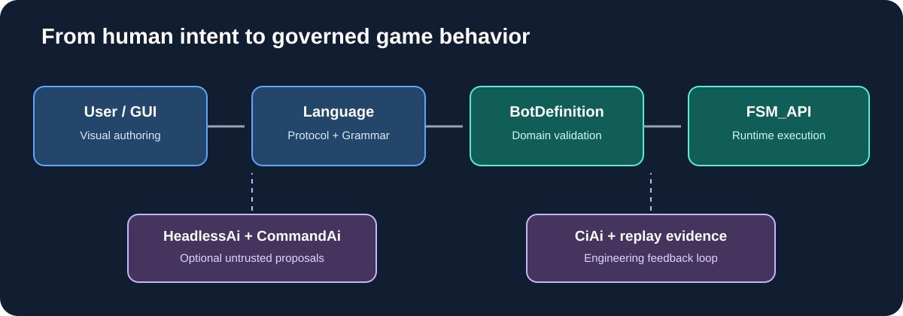

# Research: the scriptable SingularityBot

> Architecture research based on the checked-in development documentation and integration guides of the AI-branded repositories and SingularityBot. Documented capability is not proof of current bot integration.

## The question

The goal is not to bolt an LLM onto a StarCraft bot. It is to create a bot whose *behavioral DNA* can be inspected, composed, scripted, tested, visualized, and revised by people—while the live runtime remains deterministic and explainable.

A user should be able to define an opening, scouting priorities, conditional strategy adoption, defensive constraints, builder composition, and fallback behavior. The GUI should show how these definitions relate to live evidence, FSM_API contexts, goals, resource budgets, and actual outcomes.

## Read this in order

1. [Executive assessment](01-executive-assessment.md)
2. [Repository evaluations](02-repository-evaluations.md)
3. [Two architectural paths](03-two-paths.md)
4. [Recommended architecture](04-recommended-architecture.md)
5. [Graphical authoring experience](05-graphical-authoring.md)
6. [A concrete scriptable bot](06-scriptable-bot-example.md)
7. [Roadmap and decision gates](07-roadmap.md)

## Design principles

- FSM_API remains the execution foundation; no parallel FSM engine.
- SingularityBot owns StarCraft semantics, observations, strategy, legality, and action outcomes.
- AI proposes; the trusted runtime validates and disposes.
- Scripts are typed data, not arbitrary executable code.
- Evidence, freshness, guards, costs, and results are first-class.
- Adopt packages only where their contracts solve a real boundary.
- GUI, Renderer, and Visualize are MicroBundle presentation/authoring surfaces, not competing runtimes.

## Scope

CommandAi's [SingularityBot integration guide](https://github.com/TrentBest/TheSingularityWorkshop.CommandAi/blob/development/docs/SINGULARITYBOT_INTEGRATION.md) is explicitly conceptual, not a complete adapter. GrammarAi, ProtocolAi, HeadlessAi, and CiAi document relevant capabilities and boundaries. Profiles is adjacent: its domain is entity identity and disclosure, not bot strategy configuration or authorization.
